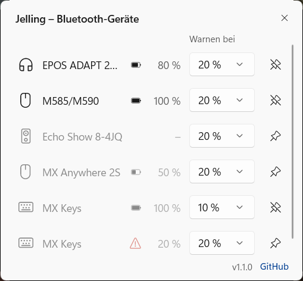
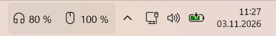
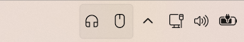

# Jelling Battery Monitor

Battery levels of your Bluetooth devices, one click away in the Windows 11 taskbar.

Jelling Battery Monitor puts a Bluetooth icon in the notification area. Click it and a flyout lists every paired device with its type and charge, styled like the Windows 11 quick settings. Devices that are switched off or out of range stay in the list, dimmed, with their last known level.

**[Download for Windows 11 (x64)](https://github.com/Gitsko/jelling/releases/latest/download/Jelling-win-x64.zip)** · [ARM64](https://github.com/Gitsko/jelling/releases/latest/download/Jelling-win-arm64.zip) · [all releases](https://github.com/Gitsko/jelling/releases)



Pinned devices sit in the taskbar next to the notification area, here a headset at 100 % and a keyboard at 50 %:



With "Show battery level as number in taskbar" turned off, only the symbols remain:



The screenshots show the German interface; on an English Windows the app is in English.

## Features

- Flyout with name, device type and battery level; the list updates by itself when a device connects, disconnects or reports a new level
- Devices in the taskbar: the pin button next to a device ("Show in taskbar") shows it in the taskbar while it is connected, left of the overflow arrow: the device symbol with its battery level to the right, black or white like the Windows icons, the level in red once it reaches the device's warning threshold. Hovering a device shows its name and level, clicking opens the flyout
- "Show battery level as number in taskbar" in the right-click menu: turned off, the taskbar shows only the symbols, and a symbol turns red at the warning threshold. The tooltip still names the level
- When the taskbar has no room left of the overflow arrow, or is vertical, the pinned devices get their own icons in the notification area instead. Jelling puts them in the taskbar rather than behind the overflow arrow; if you hide them under Settings > Personalization > Taskbar > Other system tray icons, they stay hidden. Windows remembers both as long as Jelling stays in the same folder
- Warning threshold per device: the "Warn at" list in the flyout sets the level (default 20 %, or Off) at which the device's level turns red and a notification appears. It warns once per discharge and again only after the device was charged more than 10 points above the threshold. Clicking it opens the flyout
- Start with Windows: right-click the icon. Exit is in the same menu
- Starting Jelling a second time opens the flyout of the running app instead of adding a second icon
- Light, dark and high-contrast taskbars
- English and German, following the Windows display language; other languages get English
- The flyout's bottom right shows the version and a link to this page. When a newer release is out, a small download arrow appears next to them and opens the releases page; Jelling never downloads or installs anything by itself

## Which devices show a level

Jelling shows the level Windows itself reads, the same value you see under Settings > Bluetooth & devices. Headsets, mice, keyboards and controllers that report their charge there work. A device without a level there shows "–" in Jelling as well.

## Install

Requires Windows 11 (x64 or ARM64). Nothing else: .NET and the Windows App SDK are included.

1. Download [`Jelling-Setup-win-x64.exe`](https://github.com/Gitsko/jelling/releases/latest/download/Jelling-Setup-win-x64.exe) (or [`Jelling-Setup-win-arm64.exe`](https://github.com/Gitsko/jelling/releases/latest/download/Jelling-Setup-win-arm64.exe)) from the latest release
2. Run it. It installs for your user only, without administrator rights, to `%LOCALAPPDATA%\Programs\Jelling` and adds Jelling to the Start menu

On the first install the setup offers to start Jelling with Windows, ticked unless you untick it.

The setup is not code-signed, so SmartScreen may warn when you run it. Choose "More info" and then "Run anyway". With Smart App Control turned on, Windows blocks unsigned programs like this one and offers no "Run anyway".

To check the download, compare `Get-FileHash Jelling-Setup-win-x64.exe` in PowerShell with the release's `SHA256SUMS.txt`. With the GitHub CLI, `gh attestation verify Jelling-Setup-win-x64.exe --repo Gitsko/jelling --signer-workflow Gitsko/jelling/.github/workflows/ci.yml` also confirms that the file was built by this repository's release workflow. Both work the same for the ZIPs.

To update, run the setup of the new version. It closes Jelling, replaces its files and starts it again; settings, "Start with Windows" and the taskbar positions stay. Run over a copy unzipped to `%LOCALAPPDATA%\Programs\Jelling` from an earlier ZIP, the setup replaces it in place: settings and taskbar positions stay, and it asks about starting with Windows as on a first install. A copy in another folder is left alone; exit it and delete its folder first, or the new Jelling hands over to the old one still running.

To uninstall, open Settings > Apps > Installed apps and uninstall "Jelling Battery Monitor". This closes the app and removes it from autostart. Settings (`settings.json`) and the error log (`crash.log`, older entries in `crash.old.log`) live in `%LOCALAPPDATA%\Jelling` and stay; delete that folder too if you want them gone.

### Without setup

Each release also has a ZIP: [`Jelling-win-x64.zip`](https://github.com/Gitsko/jelling/releases/latest/download/Jelling-win-x64.zip) or [`Jelling-win-arm64.zip`](https://github.com/Gitsko/jelling/releases/latest/download/Jelling-win-arm64.zip). Before unzipping, open its properties and tick "Unblock" so SmartScreen does not warn. Then unzip it to a folder that stays and run `Jelling.App.exe`. If you move the folder later, turn "Start with Windows" on again.

To update, exit Jelling from the right-click menu and replace the folder's contents with the new ZIP. To uninstall, turn off "Start with Windows", exit the app and delete its folder and `%LOCALAPPDATA%\Jelling`.

When reporting a problem, attaching `crash.log` helps. Paths under your user folder are written as `%USERPROFILE%` (entries from version 1.0.1 and older still show them in full), and device names can appear, so read it through before posting.

## Privacy

Jelling reads the battery levels from Windows and keeps everything on your PC. The only network access is the update check: a minute after start and then once a day it asks the GitHub API (`api.github.com/repos/Gitsko/jelling/releases/latest`) for the newest version number. The request carries the app version in its User-Agent and nothing about your devices.

## Build from source

Needs the .NET 10 SDK on Windows.

```
dotnet build Jelling.slnx
dotnet test Jelling.slnx --no-build
```

A self-contained build like the release (for ARM64 use `-r win-arm64 -p:Platform=ARM64 -o artifacts/publish/win-arm64`):

```
dotnet publish src/Jelling.App/Jelling.App.csproj -c Release -r win-x64 -p:Platform=x64 -o artifacts/publish/win-x64
```

The setup is built from that output with [Inno Setup](https://jrsoftware.org/isinfo.php) 7; `tools\Install-InnoSetup.ps1` installs the version CI uses and prints the path of its `ISCC.exe`. The script finds the output at the path above (for ARM64 add `/DArch=arm64`) and writes the setup to `artifacts\installer`:

```
ISCC installer\jelling.iss
```

Pushing a tag like `v1.2.0` builds both setups and ZIPs in GitHub Actions and attaches them to a release.

## Not planned

- Vendor protocols (Logitech, Sony, Bose): each needs its own reverse engineering and test hardware
- AirPods: Apple only exposes estimates in proprietary advertisements
- Connecting or disconnecting devices: Windows already does that well
- A widget for the Windows Widgets board: it cannot refresh often enough

## License

MIT, see [LICENSE](LICENSE).
